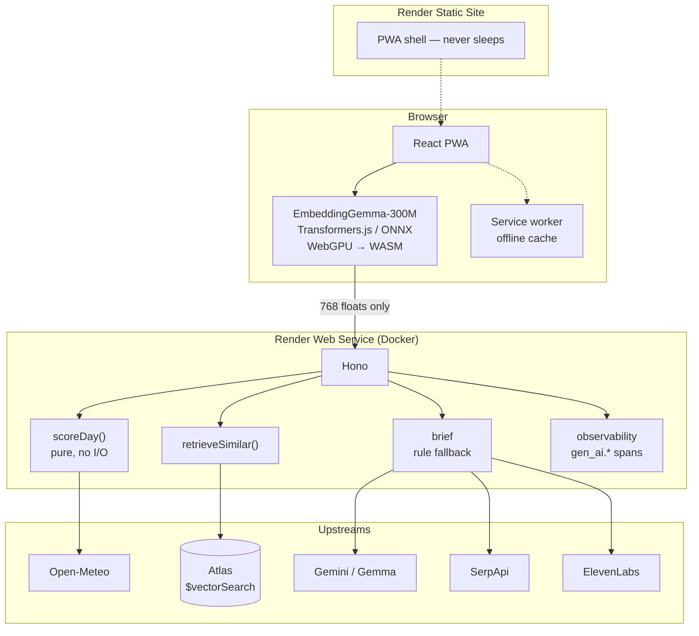

# Khoj

**Decide which Saturday is worth the drive.**

Khoj scores hiking conditions for six trails in northern Pakistan, shows its
working, and tells you what actually happened on past days that felt the same.
Open-weight models run in your browser.

Built for the [Hacktoberfest Open-Source AI Challenge, Week 1 — *Touch Grass*](https://dev.to/challenges/hacktoberfest-week1-2026-10-05).

> **Live demo:** https://khoj-afo4.onrender.com
> **Submission post:** [`DEV.md`](DEV.md)

---

## The problem

Babusar is six hours from Islamabad each way. If you set out on a bad day, that
is a wasted weekend. Post-monsoon mud, ridge wind and first snow above 3,000 m
can each close a trail, and finding out at the trailhead is too late.

Generic weather apps forecast the city. They are meaningless for a ridge 2,000 m
above it.

## The six trails

| Trail | Elevation | Difficulty | Typical | What it's known for |
|---|---|---|---|---|
| Daman-e-Koh | 1,300 m | easy | 3 h | Paved and railed; works in almost any weather |
| Margalla Hills NP | 1,500 m | easy | 4 h | Park network, wildlife most likely at dawn |
| Murree | 2,300 m | moderate | 4 h | Pine forest; lower paths turn to mud fast |
| Galiyat | 2,600 m | moderate | 5 h | Autumn colour; exposed ridge wind |
| Kaghan | 1,900 m | moderate | 5 h | Valley meadows that hold water after rain |
| Babusar | 3,800 m | hard | 7 h | The pass. First snow closes it in October |

Adding a trail is a **data-only** change — one entry in [`data/trails.json`](data/trails.json),
no code.

## What it does

1. Pick a trail and a date range (3, 7 or 16 days)
2. Get a verdict per day — **GO / MAYBE / NO** — with every penalty named
3. See past days on that trail with similar conditions, and what was reported
4. Hear a three-sentence brief, or read it
5. Close the browser

Works offline after the first load, and needs no account.

## The score is arithmetic, not a model

```
score = 100
  − precipPenalty   rain today, steep curve above 2 mm          max 35
  − mudPenalty      rain over the prior 3 days                  max 30
  − windPenalty     ridge wind, ramp above 20 km/h              max 20
  − heatPenalty     above 32 °C                                 max 20
  − visPenalty      fog (codes 45/48)                           max 15
  − snowPenalty     snowfall × elevation                        max 35
  + daylightBonus   withheld once penalties exceed 40           max 10

GO ≥ 70    MAYBE 45–69    NO < 45
```

Every term is a pure function — no clock, no I/O, no network — with its own test.
You should be able to audit a number before skipping a six-hour drive for it. A
model could not give you that.

**The viability ceiling** is the rule I'd defend hardest: once penalties pass 40,
the daylight bonus is withheld. Without it a long sunny day can lift a mud-soaked
trail out of NO into MAYBE, and a long day does not help when the ground is a
mudslide. A test caught that; a better idea didn't.

### The elevation term, which is the point

`0.28 cm` of snow at 1,300 m is nothing. `7.42 cm` at 3,800 m is the pass closing.
The model knows that because `snowPenalty` scales linearly between 2,000 m and
3,800 m.

Same forecast week, two trails, live from the deployed app:

| Date | Babusar (3,800 m) | Daman-e-Koh (1,300 m) |
|---|---|---|
| Oct 12 | **100 GO** — `snowPenalty=3.4` | **100 GO** |
| Oct 13 | **52 MAYBE** — `precip=12.7`, `snow=35` | **100 GO** — `precipPenalty` only |
| Oct 14 | **42 NO** — `precip=23.2`, `snow=35` | **100 GO** — `precipPenalty` only |

## The open model does retrieval

Matching *"muddy after rain, stream running high, everything underfoot soggy"*
against *"Lower trail impassable past the waterfall"* is not something a lookup
table can do, and not something token overlap does reliably.

[EmbeddingGemma-300M](https://huggingface.co/onnx-community/embeddinggemma-300m-ONNX)
— Google's open embedding model, from the Gemma family — runs **in the browser**
via [Transformers.js](https://github.com/huggingface/transformers.js), with WebGPU
and a WASM fallback. The conditions text never leaves the device; only a
768-float vector crosses the network.

Measured, on a query that appears nowhere in the corpus:

| | Top hit | Score |
|---|---|---|
| **Embedding** | Galiyat — *"Lower trail impassable past the waterfall"* | **0.911** |
| **Keyword fallback** | Murree records — wrong trails entirely | 0.375 |

Reproduce it: `npm run probe:atlas`

Briefs are written by `gemini-2.5-flash` on Vertex AI and narrated with
ElevenLabs. The model is **given** the score; it never computes one.

## Architecture

Two Render services from one repository, because a single Node process would put
the free-tier cold start *before first paint*:



The client makes **two** calls on purpose. The first returns the scored days and
renders immediately; only then is the focal day's conditions embedded, locally,
and a second call carries the vector for real retrieval. So the verdict is never
gated on a ~300 MB model download, and the app is fully useful on first paint.

Full detail in [docs/ARCHITECTURE.md](docs/ARCHITECTURE.md).

## Stack

| Layer | Choice |
|---|---|
| Client | React 19, TypeScript, Vite 8, Tailwind 4, shadcn/ui (Base UI) |
| Local model | EmbeddingGemma-300M via Transformers.js (ONNX, WebGPU → WASM) |
| API | Hono on Node 24 |
| Data | MongoDB Atlas (`$vectorSearch`), Open-Meteo (no key required) |
| AI | Gemini 2.5 Flash on Vertex AI for briefs, ElevenLabs for speech |
| Obs | Sentry `gen_ai.*` spans |
| Deploy | Render Static Site + Render Web Service |

No Python anywhere in the runtime. One language, end to end.

## Quick start

```bash
git clone https://github.com/Talha-Tahir2001/khoj.git
cd khoj
npm install          # npm workspaces — installs client, server, shared

cp .env.example .env # then fill in the keys you have

npm run check:keys   # tells you what each credential can actually reach
npm run dev:server   # Hono API on :3000
npm run dev:client   # Vite on :5173, proxies /api → :3000
```

**Run `check:keys` first.** It will tell you exactly which integrations are live
before you start chasing a blank screen.

### Environment

Every key has a defined fallback and the response says which path ran. The app
**starts and serves with an empty `.env`** — a missing key must never mean a
blank screen.

| Variable | Required | If missing |
|---|---|---|
| `MONGO_URI` | for `$vectorSearch` + cross-restart cache | Keyword-match retrieval, in-memory cache |
| `GEMINI_API_KEY` | no | Rule-based brief from the same numbers |
| `GOOGLE_CLOUD_PROJECT` | no | AI Studio only, instead of Vertex |
| `ELEVENLABS_API_KEY` | no | Text brief, no audio |
| `SERPAPI_KEY` | no | Live-reports section omitted |
| `SENTRY_DSN` | no | No `gen_ai.*` traces |
| `PUBLIC_SITE_ORIGIN` | in production | CORS rejects the static site |
| `DNS_SERVERS` | no | Only needed on networks that mishandle DNS SRV |

See [`.env.example`](.env.example) — it's commented with the traps.

## Verification

Everything below was run, not assumed. Reproduce any of it.

```bash
npm test              # 94 tests
npm run check:keys    # what each credential can actually reach
npm run verify:trails # retrieval non-empty for all six trails (gate)
npm run probe:atlas   # semantic vs keyword, side by side
npm run probe:e2e     # through the running API, as the browser does
npm run seed:atlas    # embed the corpus, create the vector index
```

| Claim | How it was checked | Result |
|---|---|---|
| Six trails score with visible penalties | Live request per trail | All six; Babusar **42 NO** on Oct 14, Daman-e-Koh **100** |
| Elevation scales the snow penalty | Same forecast, two elevations | Non-zero at 3,800 m, null at 1,300 m |
| EmbeddingGemma emits 768 dims | Model loaded and run | **768** — confirms the Atlas `numDimensions` |
| Vector survives the base64 hop | 768 floats → 4,096 chars → decode | Exact, first element matches to 1e-7 |
| Retrieval beats keyword search | Same query, both paths | **0.911** vs 0.375, wrong trails in the fallback |
| `$vectorSearch` serves in production | Real vector, deployed API | Confirmed on all trails |
| Caching works | Two identical requests | `X-Cache: MISS` then `HIT` |
| Error contract holds | Four bad requests, live | `UNKNOWN_TRAIL`, `INVALID_DAYS`, `INVALID_EMBEDDING` correct |
| Voice returns real audio | Decoded the response | Valid MP3, ID3-tagged |
| Zero known vulnerabilities | `npm audit` | **0** |

### Traps worth knowing before you debug anything

- **ElevenLabs `402` is a plan restriction, not billing.** Free tiers can't use
  premade *library* voices, and it says so in a way that reads exactly like
  exhausted credits. The app probes for a usable voice.
- **AI Studio and Vertex AI bill different projects.** A `402` on one says nothing
  about the other. Also their model paths differ — Vertex needs
  `/publishers/google/models/<id>`.
- **Atlas Search indexes are invisible to `listIndexes()`.** Only
  `$listSearchIndexes` sees them. A diagnostic using the former reports a working
  index as missing.
- **`$vectorSearch` `queryVector` must be a plain `number[]`.** TypeScript
  accepts `Float32Array`; the live index rejects it.
- **SerpApi returns `200` with an empty body** when the key is missing — which
  looks like thin coverage.
- **The base64 vector needs `URLSearchParams`.** `btoa` emits `+`, and a `+` in a
  query string decodes as a space.

## Deploying

Both services deploy from [`render.yaml`](render.yaml).

**Static Site**

| Field | Value |
|---|---|
| Root Directory | *blank* — this is an npm workspaces monorepo |
| Build Command | `npm ci && npm run build` |
| Publish Directory | `./client/dist` |
| Environment | `VITE_API_BASE=https://<api-service>.onrender.com/api` |

**Web Service**

| Field | Value |
|---|---|
| Runtime | Docker |
| Root Directory | *blank* — `Dockerfile` is at the repo root |
| Health Check Path | `/api/health` |

Then set `KHOJ_HEALTH_URL` as a GitHub secret to
`https://<api-service>.onrender.com/api/health`. The
[keep-warm workflow](.github/workflows/keep-warm.yml) pings it every 10 minutes
because free instances sleep after 15 — and a judge clicking your link during
that window sees a spinner. It must target `/api/health`, not `/robots.txt`;
Render serves the latter without waking the instance.

## Tests

```bash
npm test
```

94 tests. The scoring suite is the important one — it proves each penalty fires
in isolation and never fires below its threshold, which is what makes the score
auditable. The rest cover the mud lookback window, the conditions text that
client and server must agree on, the rule-based brief, the timeouts, and the
circuit breakers.

## Project structure

```
shared/     scoring rules and types, imported by both packages
data/       trails.json and the observation corpus — no build step
scripts/    seeding, credential checks, probes
client/src/ embed.ts (local model), api.ts, App.tsx, sw.ts
server/src/ routes/advice.ts orchestrates; lib/ is one concern per file
```

## Docs

| Doc | What's in it |
|---|---|
| [PRD.md](PRD.md) | Requirements and the design decisions behind them |
| [PLAN.md](PLAN.md) | Build plan, gates, risks, cut list |
| [DEV.md](DEV.md) | The challenge submission post |
| [docs/ARCHITECTURE.md](docs/ARCHITECTURE.md) | Two-service split, request lifecycle, timeouts, caching |
| [docs/API.md](docs/API.md) | Endpoint contracts, with verified behaviour |
| [docs/DATA.md](docs/DATA.md) | Open-Meteo schema, corpus format, Atlas index |
| [docs/JUDGING_MAP.md](docs/JUDGING_MAP.md) | Criteria → evidence, with gate status |
| [THIRD_PARTY.md](THIRD_PARTY.md) | Licences and weight provenance |

## Limitations

Stated plainly, because they'd otherwise cost your trust:

- **The score is deterministic rules.** The model does retrieval and narration
  only. It never computes a score, and it is given one.
- **The corpus is small and hand-seeded** — 24 records, four per trail. Retrieval
  works; it is not robust. First-hand notes from trips you have actually taken
  are worth more than anything generated here.
- **The thresholds are plausible, not calibrated.** Nobody has a labelled dataset
  of "did this hike go well" for these trails.
- **Mountain forecasts are reanalysis-derived**, and are the hardest case for
  Open-Meteo. Babusar at 3,800 m is the least reliable row in the app.
- **Forecast skill degrades past ~10 days.** The 16-day view is shown honestly,
  but the UI should weight later days lower. It doesn't yet.
- **Thunderstorms are not scored** (codes 95–99) because the source can't
  reliably derive them. Fine in October, wrong in July.
- **The mud penalty can't see rain before the forecast window opens.** Open-Meteo
  returns a forward window only, so day 0 always scores zero prior rainfall.
- **Live trail reports come from web search**, and SerpApi coverage of Pakistani
  trails is thin. The section is omitted when empty rather than padded.
- **The briefing model is hosted, not open-weight.** `gemma-4-31b-it` is tried
  first and reported when it works; right now a plan restriction sends it to a
  hosted `gemini-2.5-flash`, and the app says so rather than claiming Gemma.
- **Trail coordinates are unverified.** See the checklist in [PLAN.md](PLAN.md).
- **There is no field report yet.** The app has not been validated against a real
  trip, which is the most important gap on this list.

## Contributing

Issues and PRs welcome. Two things to keep intact if you touch them:

- **`shared/scoring-rules.ts` is the single source of truth.** Client and server
  both import it, so the two cannot disagree about what "GO" means.
- **Every upstream must keep a fallback.** A feature that disappears entirely
  when a key is missing is worse than one that degrades loudly.

```bash
npm test && npm run typecheck && npm run build
```

## License

MIT — see [LICENSE](LICENSE).

Model weights and data carry their own terms. **EmbeddingGemma and the Gemma
family are licensed by Google under the Gemma terms of use, which restrict
commercial use without a separate agreement** — Khoj is non-commercial. Read
[THIRD_PARTY.md](THIRD_PARTY.md) before reusing anything.

Forecast data by [Open-Meteo](https://open-meteo.com/) (CC BY 4.0) — attribution
required, and it is shown in the app footer.