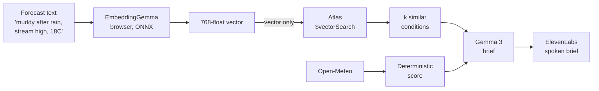

# Khoj — DEV submission draft

> **Status:** draft, ~70% complete. Written to plan mode to build mode.
> **Before publishing:** fill every `{{...}}`, delete this blockquote, and verify every
> claim in the post is actually true. Do not publish aspirational claims.
> **Required tags:** `#devchallenge` `#hf26challenge`
> **AI disclosure:** the post is agent-drafted. Disclose as the platform requires.

---

# Khoj: I built a hike planner that tells you which Saturday is worth the drive

*This is a submission for the [Hacktoberfest Open-Source AI Challenge Week 1: Touch Grass](https://dev.to/challenges/hacktoberfest-week1-2026-10-05)*

{{One-sentence hook. e.g. "It told me Galiyat was fine on Saturday. It was not, and here's why that was my fault and not the model's."}}

## The problem with a six-hour drive

{{Your real story. Babusar is six hours each way. If you set out on a bad day, that is a
wasted weekend. How did you decide before this?}}

I kept running into the same problem: a free Saturday, a car, and six trails I know by
name but whose conditions I had no way to check. Every weather app gives me Islamabad.
None of them tell me anything about a ridge 2,600 metres above it.

So I built Khoj. You pick a trail, you get a verdict per day, and you find out why.

**Live demo:** {{URL}}
**Repo:** {{URL}}

## What it actually does

1. Pick a trail and a date range
2. Get a verdict per day — GO / MAYBE / NO — with every penalty named
3. See past days that felt the same, and what was reported
4. Hear a three-sentence brief
5. Close the browser

{{Screenshot: verdict cards. Show the penalties expanded — that is the interesting part.}}

## The part I want to be honest about first

**The score is arithmetic, not a model.**

Every point deducted comes from a named penalty: mud from recent rain, ridge wind,
heat, valley fog, early snow above 3,000 m. Each one is a unit-tested pure function.
If Khoj says NO, you can see exactly which term did it.

I made that choice deliberately. If you're about to skip a six-hour drive on my
recommendation, "a transformer said 62" is not a reason to trust me. Eighteen points
off for mud, because there was 34 mm of rain in the last three days, is.

{{Screenshot or code: the scoring function.}}

## So where does the open model do real work?

Retrieval.

When the forecast says "muddy after rain, stream crossing high, 18°C," I want to
show you a note someone left about a day that felt like that. Written as *"the lower
path was a mess after Wednesday's rain, had to wade the stream."* Lexical matching
fails on that. A lookup table can't do it at all.

So [EmbeddingGemma](https://huggingface.co/onnx-community/embeddinggemma-300m-ONNX)
— Google's open embedding model, from the Gemma family — runs **in the browser** via
[Transformers.js](https://github.com/huggingface/transformers.js).

### The part I did not expect to care about

The vector crosses the network. The text does not.

That was a design consequence, not a slogan. There is no location input anywhere in
Khoj — you pick from a public catalog — and the only thing the server receives about
your conditions is a 768-float vector it cannot read. It cannot know that you were
planning a drive home at 6am in the rain.

{{If true: mention this reads like marketing unless you show the request. Include a
screenshot of the network payload or a line of code that proves it.}}

## Why open won here

{{Answer the challenge's question directly. Pick the two or three that genuinely apply
to what you built. Do not list all of them — a list reads as a form field.}}

- **It costs nothing to run.** No API key, no per-request fee, no token budget. A hiking
  group can run it on every trip indefinitely.
- **Your conditions text stays on your device.** Because the embedding model is a file
  you download, not a service you call.
- **I can swap models.** EmbeddingGemma, MiniLM, anything ONNX-shaped — one constant.
  {{If you actually swapped one: say so and show both results.}}
- **It runs where there's signal.** {{Only claim this if you tested it.}}

The honest counterweight: Gemma 3 runs through Google Cloud, not locally. I chose that
for the briefing layer because it is the one task where quality per second actually
matters, and I do not need the text to stay private for that — the score is already
computed by then.

{{If you did manage a local fallback, describe it. If not, this paragraph is enough —
admitting the boundary is stronger than hiding it.}}

## Architecture in one diagram

{{Mermaid diagram}}

## The scores

{{Table: this is the section that shows technical execution. Every penalty named,
with the test that proves it fires in isolation.}}

| Penalty | Trigger | Points | Test |
|---|---|---|---|
| `precipPenalty` | precipitation_sum, steep above 2 mm | up to 35 | fires at 2 mm, not at 1.9 |
| `mudPenalty` | precip over prior 3 days | up to 30 | |
| `windPenalty` | wind_speed_10m_max, ramp above 20 km/h | up to 20 | |
| `heatPenalty` | temperature_2m_max above 32 °C | up to 20 | |
| `visPenalty` | weather_code 45/48 | up to 15 | |
| `snowPenalty` | snowfall_sum × elevation | up to 35 | zero at 1,300 m, non-zero at 3,800 m |
| `daylightBonus` | daylight_duration, withheld past 40 penalty points | up to 10 | |

> The viability ceiling was the one rule I got wrong at first. I had the daylight
> bonus applying unconditionally, and the tests caught a rainy, muddy day scoring
> 50 — MAYBE — because the sun was out. A long day does not help when the ground is
> a mudslide, so the bonus is now withheld once penalties pass 40. That came from a
> failing test, not from a better idea.

{{Fill in real numbers from the running app. Do not invent them.}}

{{If you benchmarked against baselines, put that table here. If you did not, delete this
paragraph rather than writing something vague.}}

## What happened when I used it for real

{{THE FIELD REPORT. This is the section that separates this from the other entries.
Daman-e-Koh, {{date}}. What the app said. What the weather was. What I got wrong.}}

{{Include: the verdict it gave, whether it was right, and anything it missed. If it got
something wrong, that paragraph is worth more than three paragraphs of it working.}}

## What I'd fix next

{{Genuine list. These are real, and reviewers weight honesty here:}}

- **The corpus is small.** {{N}} hand-seeded observations across six trails. Retrieval
  works; it is not robust. It needs real logged conditions.
- **The thresholds are guessed.** Every penalty weight is plausible, not calibrated
  against labelled outcomes. Nobody has that dataset.
- **Mountain forecasts are the hard case.** Open-Meteo is reanalysis-derived and
  terrain this steep is exactly where that struggles. Babusar at 3,800 m is the
  least reliable row in the app.
- **Thunderstorms aren't scored.** Codes 95–99 are ignored because the source can't
  reliably derive them. Fine in October, wrong in July.
- **Weather skill degrades past ten days.** The 16-day view is honest about being a
  guess, and the UI should probably weight later days lower. It doesn't yet.

## Partner categories

{{List all seven by name. Nomination is opt-in — an unnamed category is forfeited.}}

- **Best Use of Gemma** — EmbeddingGemma running locally in the browser via
  Transformers.js for retrieval, plus Gemma 3 for the briefing layer
- **Best Use of Render** — Static Site for the CDN-hosted PWA shell plus a Web Service
  for the API, deployed from `render.yaml` with a keep-alive cron
- **Best Use of MongoDB Atlas** — `$vectorSearch` as the retrieval layer over condition
  embeddings, plus TTL caching for every upstream call
- **Best Use of Sentry** — `gen_ai.invoke_agent` parent span with `gen_ai.chat` and
  `gen_ai.execute_tool` children, tracing every model and tool call
- **Best Use of SerpApi** — live trail reports, cached aggressively against a 250-search budget
- **Best Use of ElevenLabs** — the spoken brief, so you can listen in the car instead of
  reading at a light
- **Best Use of Entire** — {{agent session embedded or linked}}

## Sentry numbers

{{Table: latency and token usage per span. The category explicitly asks for this, and
real numbers are more convincing than adjectives.}}

| Operation | p50 | p95 | Tokens |
|---|---|---|---|
| `chat {{model}}` | | | |
| `execute_tool get_forecast` | | | |
| `execute_tool search_live_reports` | | | |

## Show your work

{{Embed or link the agent session.}}

## License

Code is MIT. Model weights and data carry their own terms — see `THIRD_PARTY.md` for
full provenance. {{Mention that this was done deliberately and why attribution accuracy
matters when you redistribute weights.}}

---

## Pre-publish checklist

- [ ] Every `{{placeholder}}` filled
- [ ] Every numeric claim matches the running app
- [ ] Field report actually written from a real trip
- [ ] Demo URL loads
- [ ] Screenshots taken on a phone
- [ ] All seven partner categories named
- [ ] `#devchallenge` + `#hf26challenge` applied
- [ ] AI disclosure set correctly
- [ ] Read the "what I'd fix next" section — is everything there still true?
- [ ] Claims re-checked against reality. Delete anything you cannot defend.